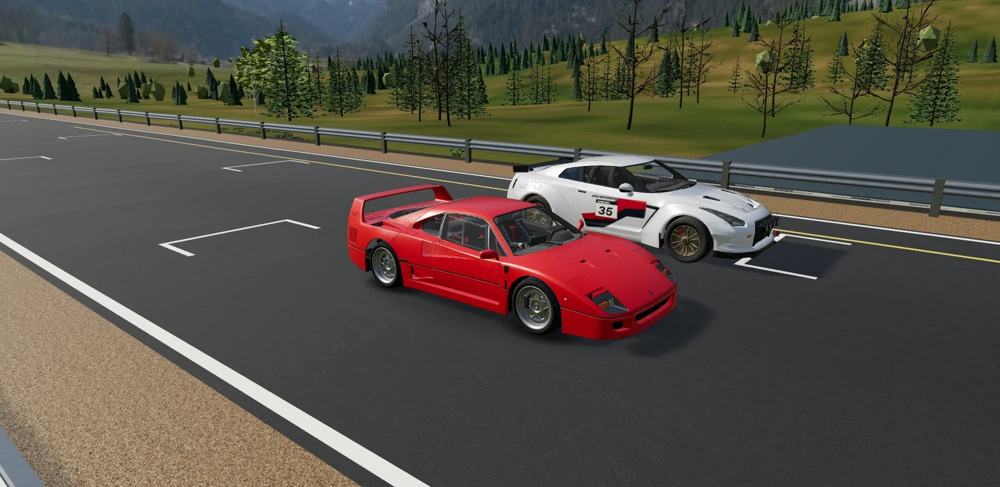
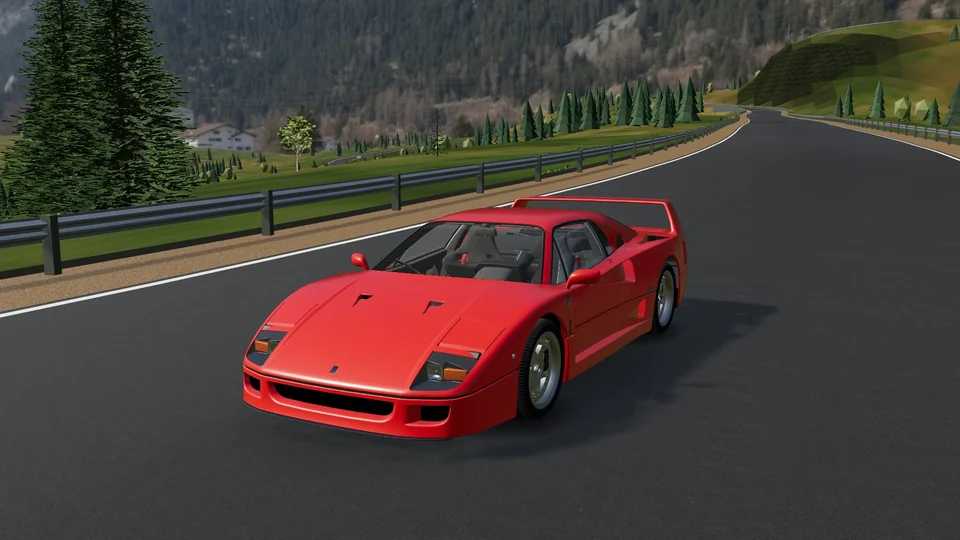
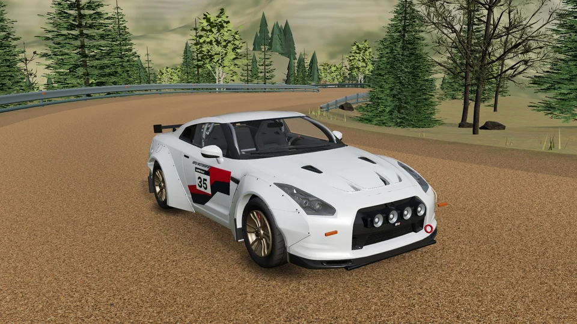
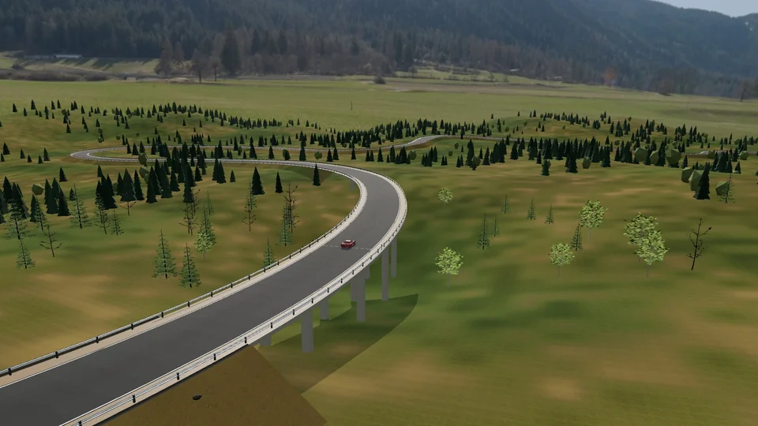
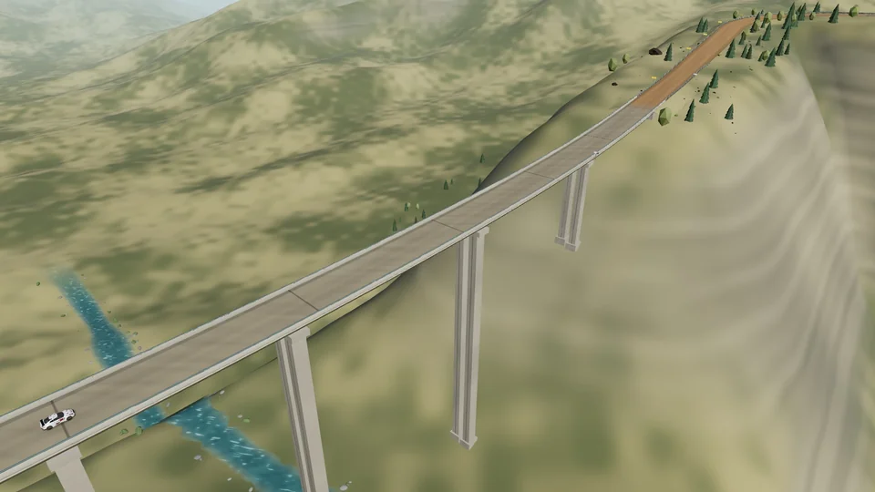

<strong>English</strong> · <a href="README.zh-CN.md">简体中文</a>

<h1 align="center">Project Apex Drive Online</h1>

A 3D driving simulator you can play in your browser, solo or in rooms for two to six drivers.

<strong><a href="https://apex-drive-network-poc.tigerzhang0215.workers.dev/play/">Play Online →</a></strong> · <a href="https://github.com/tigerzhang20252025-blip/project-apex-drive-online/releases/tag/v0.2.1">v0.2.1</a> · <a href="https://github.com/tigerzhang20252025-blip/project-apex-drive-offline">Offline Edition</a>

## Get on track

1. Open **Play Online** in a desktop browser with **WebGL 2** and use a keyboard. For solo driving, pick a car and course in the garage, select **Drive**, then click **Start engine** or press **I**.
2. To race with friends, choose **Multiplayer**. Select **Create Room** and share the invite code, or enter a code and select **Join Room**. Everyone chooses their own car.
3. The host picks a course and mode. Each driver selects **Ready**, then the host selects **Start Session**. In **Free Drive**, explore at your own pace. **Best Stage Challenge** on Pineglass and **Best Lap Challenge** on Alpine rank each driver’s fastest valid time in a ten-minute session.

Public rooms last up to 75 minutes. The relay supports up to three active rooms and five reserved room-hours per rolling day. Other drivers’ cars are synchronized visually. Collisions apply to the course only. [Multiplayer guide, reconnecting, and LAN play](docs/MULTIPLAYER.md)

## Cars

  
  

- **Ferrari F40** · Rear-wheel drive, a five-speed gated gearbox, a mechanical ignition key, and pop-up headlights.
- **Nissan GT-R R35 Rally Edition** · A fictional all-wheel-drive rally build with a six-speed gearbox, paddle shifters, and a brake-to-start cockpit button.

Both cars have automatic and manual modes, working cockpit instruments and mirrors, synthesized engine audio, and cockpit, chase, hood, and orbit cameras.

## Courses

  
  

- **Alpine Proving Ground** · A 5.014 km asphalt circuit with fast climbs, linked corners, and lap and sector timing.
- **Pineglass Run 2.0** · A 6.554 km point-to-point gravel stage from the forest to the valley via Quarry Hook and the Glass Gorge viaduct. It features stage and sector timing, dust, and recovery to a safe point. [Pineglass course guide](docs/PINEGLASS_RUN.md)

## Controls

| Action | Keys |
| --- | --- |
| Accelerate, brake, steer | **W / S / A / D** or arrow keys |
| Start or stop the engine | **I** or the HUD button |
| Switch auto/manual when stopped | **T** or the F40 cockpit **AUTO/MAN** rocker |
| Downshift, upshift, handbrake | **Q / E / Space** |
| Cycle cameras, look around | **C** · right-drag in cockpit |
| Reset, recover on Pineglass, pause | **R / Backspace / Esc** |

In the GT-R cockpit, press **G** to look at the console. Hold **S** or **↓** and click **ENGINE START/STOP** to start. Open **Help → Controls** for the full list or **Settings → Keyboard bindings** to rebind controls.

## Release and credits

**v0.2.1** adds the F40 transmission rocker and the GT-R cockpit start interlock, and fixes mountain flicker near the Pineglass crest. [Release notes](https://github.com/tigerzhang20252025-blip/project-apex-drive-online/releases/tag/v0.2.1) · [Changelog](CHANGELOG.md) · [Development guide](docs/DEVELOPMENT.md)

Based on Project Apex Drive by **jinyuze2028-source and the original contributors**. The game source uses the MIT license. The vehicle models are adapted from Black Snow’s work under CC BY 4.0. [Original project](https://github.com/jinyuze2028-source/project-apex-drive) · [MIT license](LICENSE) · [Asset credits](THIRD_PARTY_NOTICES.md)
