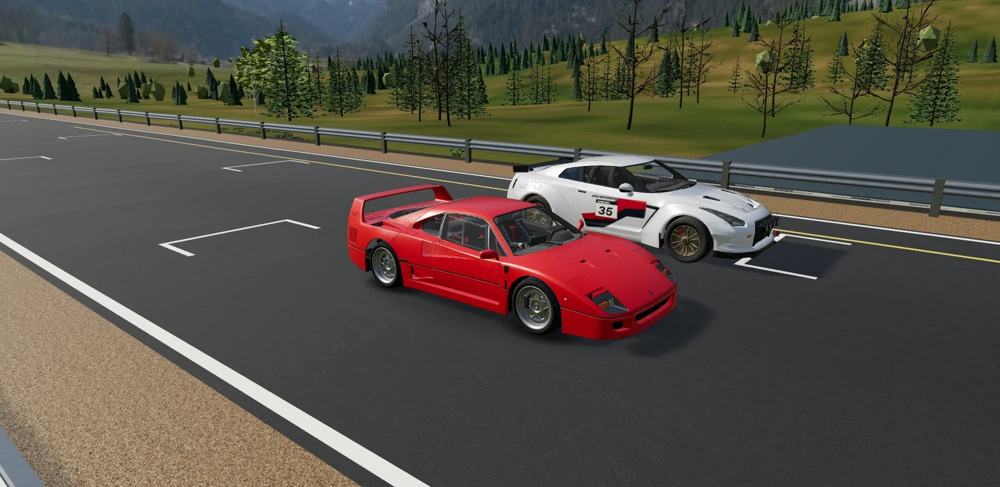
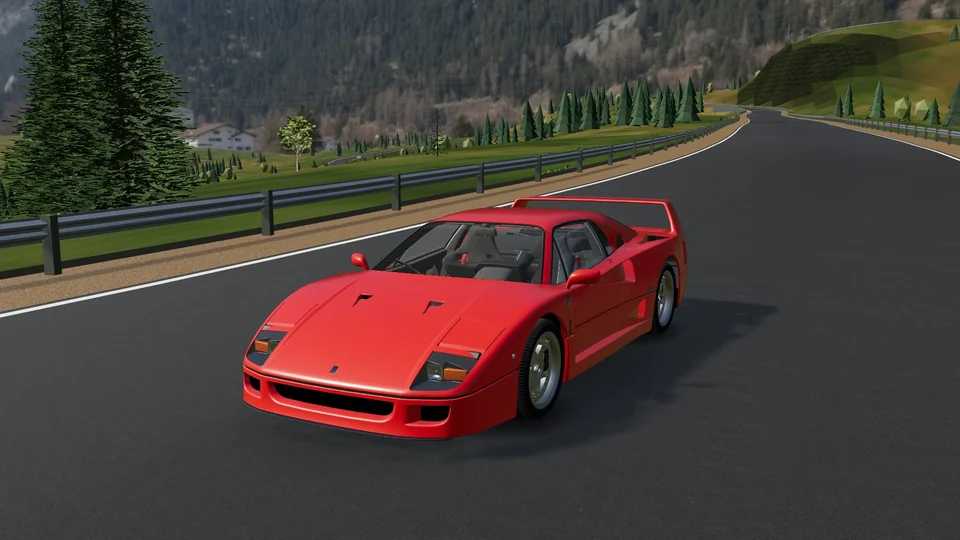
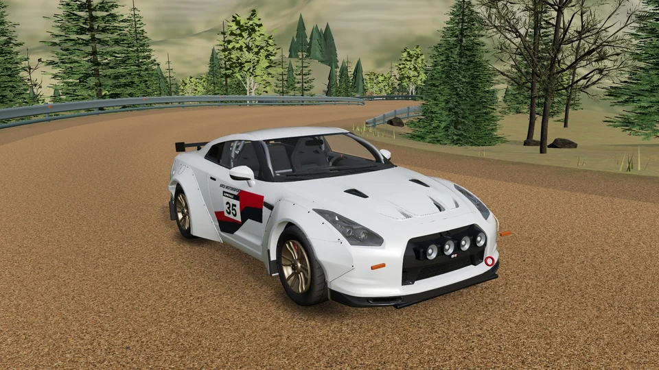
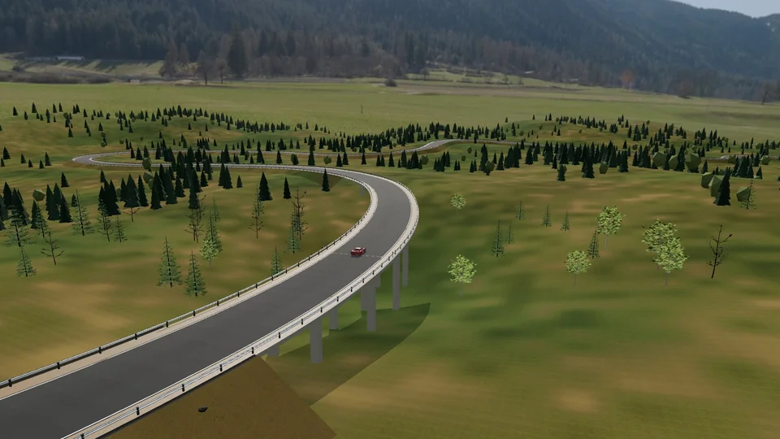
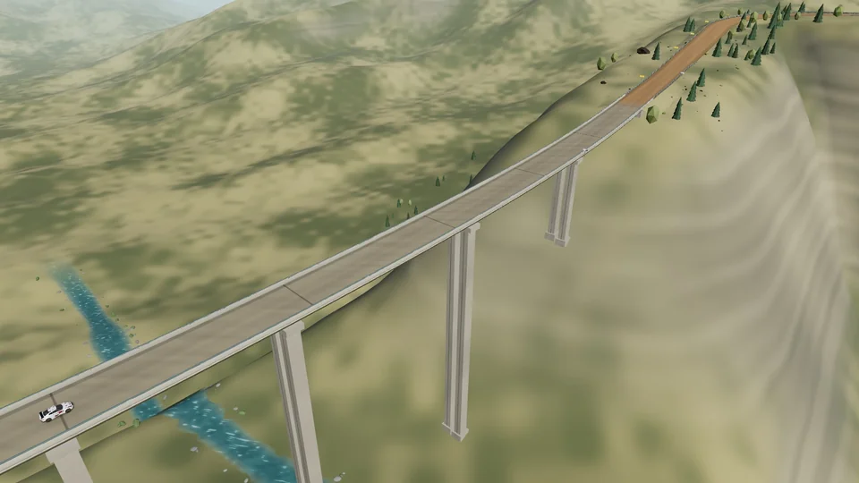

<a href="README.md">English</a> · <strong>简体中文</strong>

<h1 align="center">Project Apex Drive 在&#8288;线&#8288;版</h1>

在浏览器里直接体验的 3D 驾驶模拟游戏，支持单人驾驶和 2–6 人房间。

<strong><a href="https://apex-drive-network-poc.tigerzhang0215.workers.dev/play/">立即在线游玩 →</a></strong> · <a href="https://github.com/tigerzhang20252025-blip/project-apex-drive-online/releases/tag/v0.2.1">v0.2.1</a> · <a href="https://github.com/tigerzhang20252025-blip/project-apex-drive-offline/blob/main/README.zh-CN.md">离线版</a>

## 上路指南

1. 用支持 **WebGL 2** 的桌面浏览器打开游戏，并使用键盘操作。单人游玩时，在车库选好车辆和赛道，点击 **Drive**，再点击 **Start engine** 或按 **I** 启动。
2. 和朋友一起玩时，选择 **Multiplayer**。房主点击 **Create Room** 并分享邀请码，其他玩家输入邀请码后点击 **Join Room**。每位玩家都可以独立选车。
3. 由房主选择赛道和模式。所有玩家点击 **Ready** 后，房主点击 **Start Session** 发车。**Free Drive（自由驾驶）** 可以按自己的节奏探索赛道；Pineglass 的 **Best Stage Challenge（最佳赛段挑战）** 和 Alpine 的 **Best Lap Challenge（最佳单圈挑战）** 按十分钟内的最快有效成绩排名。

公共房间最多开放 75 分钟。服务器最多同时开放 3 间房，滚动 24 小时内合计最多可预留 5 小时。其他玩家的车辆会实时同步显示，碰撞仅发生在车辆与赛道环境之间。 [联机指南、断线重连和局域网玩法](docs/MULTIPLAYER.md)

## 车辆

  
  

- **法拉利 F40** · 后轮驱动、五速 H 型挡位、机械点火钥匙和跳灯。
- **日产 GT-R R35 拉力版** · 游戏中的虚构拉力改装，配备四轮驱动、六速变速箱、换挡拨片和需要踩刹车才能启动的座舱按钮。

两款车均支持自动挡和手动挡，配有可用的座舱仪表、后视镜和合成引擎音效，并提供座舱、第三人称跟车、引擎盖和环绕视角。

## 赛道

  
  

- **Alpine Proving Ground（高山试车场）** · 全长 5.014 公里的沥青环形赛道，包含高速爬坡与连续弯道，支持圈速和分段计时。
- **Pineglass Run 2.0** · 全长 6.554 公里的点到点碎石赛段，从森林出发，经采石场和玻璃峡谷高架桥进入山谷。支持全程与分段计时、扬尘效果和安全点救援。 [Pineglass 赛道指南](docs/PINEGLASS_RUN.md)

## 操作键位

| 操作 | 按键 |
| --- | --- |
| 加速、刹车、转向 | **W / S / A / D** 或方向键 |
| 启动或关闭引擎 | **I** 或 HUD 按钮 |
| 停车后切换自动挡和手动挡 | **T** 或 F40 座舱内的 **AUTO/MAN** 开关 |
| 降挡、升挡、手刹 | **Q / E / 空格** |
| 切换视角、环顾座舱 | **C** · 在座舱视角按住鼠标右键拖动 |
| 重置车辆、Pineglass 救援、暂停 | **R / 退格键 / Esc** |

在 GT-R 座舱里，按 **G** 看向中控台，按住 **S** 或 **↓**，再点击 **ENGINE START/STOP** 启动。完整键位见 **Help → Controls**，可在 **Settings → Keyboard bindings** 中自定义。

## 版本与致谢

**v0.2.1** 加入了 F40 座舱挡位模式开关和 GT-R 座舱踩刹车启动，并修复了 Pineglass 山脊附近的远山闪烁。 [发布说明](https://github.com/tigerzhang20252025-blip/project-apex-drive-online/releases/tag/v0.2.1) · [更新日志](CHANGELOG.md) · [开发指南](docs/DEVELOPMENT.md)

本项目基于 **jinyuze2028-source 和原项目贡献者**创作的 Project Apex Drive。游戏源代码采用 MIT 许可，车辆模型基于 Black Snow 的作品按 CC BY 4.0 许可改编。 [原项目](https://github.com/jinyuze2028-source/project-apex-drive) · [MIT 许可证](LICENSE) · [素材署名](THIRD_PARTY_NOTICES.md)
